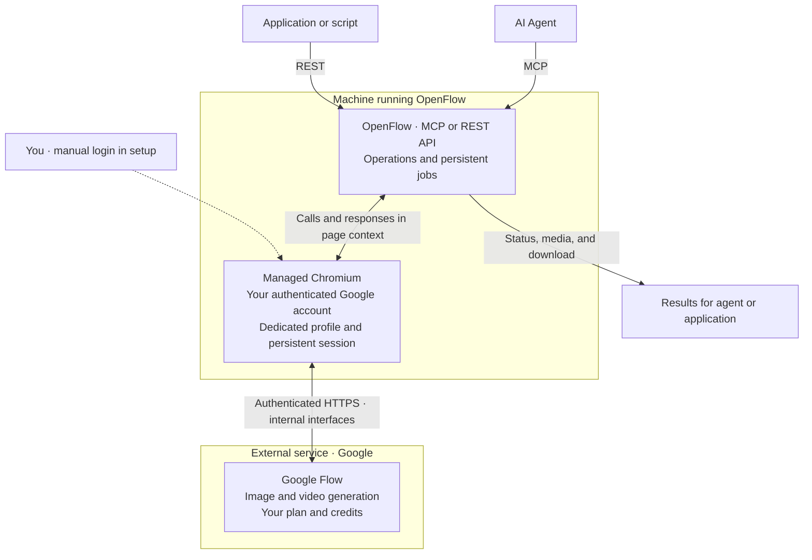

**English** | [Português (Brasil)](README.pt-BR.md)

<p align="center">
  
</p>

# OpenFlow

<a id="seu-agente-de-ia-conectado-ao-google-flow"></a>
### Your AI agent connected to Google Flow.

[](LICENSE)
[](pyproject.toml)
[](https://github.com/codexfast/openflow/stargazers)

[Get Started](#setup) · [MCP](#mcp) · [REST API](#rest) · [How it works](#architecture) · [Contributing](#contributing)

Turn requests to your agent into images and videos in Google Flow. **OpenFlow is the bridge:** an open-source project connecting agents and applications to your account via **MCP** or **REST API**, using the features and credits available on your Google plan, such as Google AI Pro.

- **Create with your agent.** Image and video generation, references, and upscale, subject to account access.
- **Choose your interface.** MCP tools for agents; REST for applications and scripts. Same service, two ways to access.
- **Review before submitting.** Preview, explicit confirmation, and persistent job history in SQLite.

Login happens directly on Google, in a dedicated Chromium instance with a persistent local profile. Afterwards, OpenFlow reuses the session in headless mode. **No extension required in the standard workflow and no manual prompt submission in the web interface.**

> **Not an official Google API.** This project uses Flow's internal interfaces and is not affiliated with or endorsed by Google. Automation may violate the service's terms or policies and could lead to restrictions, suspension, or account bans. Use at your own risk. Access, models, and credits remain subject to your plan and service availability.

> **Experimental.** Changes to Flow may break the integration. The opening artwork is conceptual, not an execution screenshot; see [provenance](docs/assets/README.md).

<a id="do-pedido-à-geração"></a>
## From prompt to generation

**Illustrative conversation example**, not an actual execution. Requires a configured MCP client, authenticated account, and selected project.

> **You:** Create a cinematic 16:9 image of a mountain cabin at sunrise.
>
> **Agent:** I prepared a preview with that prompt and the selected project. Submitting may consume Google Flow credits. Do you confirm?
>
> **You:** Confirmed.
>
> **Agent:** Submitting the confirmed operation now and tracking the job. Download becomes available once generation completes successfully.

The agent prepares with `confirm=false` and only submits after your approval, repeating the exact same inputs with `confirm=true` and `preview_id` set to the preview's `job_id`. **A preview does not generate media or substitute human authorization.** [See MCP sequence](#mcp).

<a id="índice"></a>
## Table of Contents

- [Requirements](#requirements)
- [Installation and login](#setup)
- [Features](#features)
- [How it works](#architecture)
- [MCP integration](#mcp)
- [REST API](#rest)
- [Security, account, and credits](#security)
- [Compatibility and limitations](#compatibility-and-limitations)
- [Troubleshooting](#troubleshooting)
- [Legacy backend](#legacy-backend-extension)
- [Development](#development)
- [Contributing](#contributing)
- [Contributors](#contributors)
- [Star history](#star-history)
- [Credits and license](#credits-and-license)

<a id="requirements"></a>
<a id="requisitos"></a>
## Requirements

- Python 3.11 or higher and [uv](https://docs.astral.sh/uv/getting-started/installation/).
- Google account with access to [Flow](https://flow.google.com/), such as that provided by a Google AI Pro subscription.
- Credits and model access required for each operation, according to your plan.
- Environment with a graphical interface for the initial login; afterwards, the browser can operate headlessly.
- MCP-compatible client or an application that issues HTTP calls to the REST API.

Dedicated Chromium is installed in the steps below. There is no need to install an extension or share your personal browser profile.

<a id="quick-start"></a>
<a id="setup"></a>
<a id="instalação-e-login"></a>
## Installation and login

<a id="1-instalar-dependências"></a>
### 1. Install dependencies

```bash
git clone https://github.com/codexfast/openflow.git
cd openflow
uv sync --extra browser
uv run --extra browser playwright install chromium --no-shell
```

On Linux, Playwright also requires compatible system libraries. If dependencies are missing, see the [Playwright instructions](https://playwright.dev/python/docs/browsers#install-system-dependencies). The commands above do not install system packages with administrative privileges.

<a id="2-autenticar-no-flow"></a>
### 2. Authenticate with Flow

```bash
uv run --extra browser openflow setup
```

A Chromium window will open. **Log in directly to Google and open Flow.** Password and 2FA are entered only on the website, never provided to the agent or OpenFlow.

Close the window or press Ctrl+C to finish setup and release the profile. The login is saved in the dedicated profile; if the session expires, repeat the setup.

<a id="3-iniciar-mcp-ou-rest"></a>
### 3. Start MCP or REST

| Agent with MCP tools | Application or script via REST |
| --- | --- |
| Configure your client to run the command below via stdio. | Run the API and open `http://127.0.0.1:8100/docs`. |
| `uv run --extra browser openflow` | `uv run --extra browser openflow-api --api-port 8100` |
| [MCP Setup →](#mcp) | [REST Example →](#rest) |

**The server launches the headless browser automatically.** Do not leave `setup` or `browser start` running in parallel. MCP and REST are alternatives: run one at a time using the same profile.

<a id="features"></a>
<a id="funcionalidades"></a>
## Features

| Feature | Support |
| --- | --- |
| **Images** | Nano Banana Pro, Nano Banana 2.1, and Nano Banana Lite |
| **Image aspect ratios** | `1:1`, `9:16`, `16:9`, `3:4`, `4:3`; up to 4 references |
| **Omni videos** | Text, start frame, start/end frames, or up to 3 references; 4, 6, 8, or 10 s; 360p/720p |
| **Veo Lite videos** | Start frame required, 8 s, 720p |
| **Upscale** | 2K/4K images depending on account/plan; 4K requires Ultra. 1080p videos with real `scene_id` |
| **Projects and media** | Listing and creating projects, upload, job query, and download |
| **Integrations** | MCP stdio/HTTP and REST with OpenAPI schemas |
| **Control** | Preview/confirmation, project/document context, and persistent jobs in SQLite |

Available models and features depend on account and plan. The name Nano Banana 2.1 corresponds to the identifier `nano_banana_2` in API parameters.

<a id="architecture"></a>
<a id="como-funciona"></a>
## How it works

**Your agent or application calls OpenFlow. OpenFlow accesses Google Flow through the authenticated browser using your account.**



MCP and REST are **two ways to access the same service**, not separate generation providers. Chromium maintains the session and executes authenticated calls; **Google Flow processes the generation**. OpenFlow tracks jobs and returns results to the client.

- **Direct Google login.** You enter your password and 2FA only on the website during `openflow setup`, never to the agent. Afterwards, the session can be reused in headless mode. Protect the local profile: it contains authentication data.
- **No extension in the standard workflow.** OpenFlow uses its own browser with a persistent profile, without sharing your personal profile. The diagram represents this managed backend; MCP and REST are alternatives, not two simultaneous instances on the same profile.
- **No UI generation clicking.** Operations are HTTPS calls made within the authenticated context; navigation opens the requested project before preparing a preview.
- **Project required.** Confirmation requires the same input data, project, and document as the preview. If context changes, prepare a new preview; the system does not navigate to resurrect the previous one.
- **Uncertain submissions.** Jobs with uncertain outcomes remain flagged for verification and are not automatically resubmitted.

<a id="clients"></a>
<a id="mcp"></a>
<a id="integração-mcp"></a>
## MCP Integration

OpenFlow is an **MCP tool server**, not a chat provider or OpenAI-compatible API. Use a client with MCP tool support, such as OpenCode, Claude Code, Codex, Cursor, Cline, or Hermes Agent. Each client has its own configuration format.

<a id="exemplo-opencode"></a>
### Example: OpenCode

Replace the absolute path with your clone directory. The client starts the stdio process; do not start another server manually.

```json
{
  "mcp": {
    "openflow": {
      "type": "local",
      "command": [
        "uv", "--project", "/caminho/absoluto/openflow",
        "run", "--extra", "browser", "openflow"
      ],
      "enabled": true
    }
  }
}
```

Stdio command for other clients:

```bash
uv --project /caminho/absoluto/openflow run --extra browser openflow
```

On Windows, use a path like `C:\\Projects\\openflow` in the JSON.

<a id="ferramentas-e-sequência"></a>
### Tools and sequence

1. `list_connections`: obtain the `connection_id` of the managed browser, without pairing.
2. `list_projects`: choose the desired `project_id`. Listing navigates back to home; do this **before** preparing a preview, as navigation invalidates previews belonging to another document.
3. `generate_image`, `generate_video`, `upload`, or upscale with `confirm=false`: prepare the operation. The page enters the project before binding the preview.
4. Present the inputs to the user and await approval.
5. Repeat the call with the exact same inputs, `confirm=true`, and **`preview_id` equal to the `job_id` returned in the preview**.
6. Query `get_job` with `refresh=true` when needed, and use `download` once `completed`.

`create_project` also uses preview and confirmation; after creation, the browser opens the new project. The optional `title` parameter (also in REST `POST /projects` and `/projects/preview`) accepts only a string of 1 to 200 characters, not whitespace only; the default is `"OpenFlow project"`. Repeat the same title during confirmation.

`generate_image.input.seed` is optional: `null` or omitted preserves the current random choice; a strict integer between `1` and `1000000000` sets the fixed seed sent to Flow. Booleans, strings, and fractional numbers are rejected. Repeat the same seed during confirmation; this does not guarantee identical images across model changes. Videos do not accept this parameter.

`get_account_status` and `refresh_account` verify the visible account and check the balance via HTTPS in the managed browser without opening panels. The response provides `credits`, `credits_source`, and `credits_freshness`; an unavailable reading returns `null`, never an estimated or previously cached balance.

<a id="catálogo-de-projetos-e-mídias"></a>
### Project and media catalog

`list_projects(connection_id)` and REST `GET /projects?connection_id=<uuid>` maintain the remote listing of ID/title for the first 100 projects. `has_more` indicates possible continuation; this version does not expose a cursor or guarantee all pages. Listing projects may navigate to home and invalidate previous previews.

MCP `list_project_media(connection_id, project_id, limit=100)` and REST
`GET /projects/{project_id}/media?connection_id=<uuid>&limit=100` query
media referenced by project scenes, without generating media or creating jobs.
The managed backend prepares the project under a lock; the extension requires the project tab
already selected. Both revalidate scope and document.

The response contains `items` with `media_id`, `scene_id`, `kind` (`image`, `video`, or
`unknown`), and an optional `thumbnail_url`, plus `source: "remote_project_scenes"`,
`completeness: "unknown"`, and `truncated`. The type uses media structures
identified in the project response, not `CAE`/`CAI` markers or thumbnail
format. Missing or contradictory structures remain `unknown`.

Thumbnails are verified HTTPS URLs from the observed host `lh3.googleusercontent.com`;
missing or invalid URLs yield `null`. They may expire or require authentication:
do not publish or log these links. The catalog does not download thumbnails or
make an additional request per item. It does not return original file URLs.

It does not represent all media or uploads in the project; an asset may appear in
multiple scenes. Titles, prompts, and other private fields are not exposed.
The listing and thumbnails do not grant ownership for references, downloads, or upscale.

`limit` accepts 1 to 100. `truncated` indicates only local clipping of the returned response,
not remote completeness. There is no cursor, persisted snapshot, or automatic pagination;
repeating the call fetches a fresh read. Responses with more than 1000 scenes or media items,
invalid IDs, ambiguous association, or divergent projects are rejected entirely,
including records beyond the limit. Media IDs with an `_upsampled` suffix are accepted.

<a id="exclusão-de-projeto-somente-navegador-gerenciado"></a>
### Project deletion (managed browser only)

`delete_project(connection_id, project_id, confirm=false, preview_id=null)` creates a preview
with real title and target. **Deletion is irreversible: present title and ID to the user and
await explicit approval before `confirm=true` with the same `preview_id`.**
A confirmation boolean alone does not verify human approval.

REST: `POST /projects/{project_id}/delete`, body
`{"connection_id":"<uuid>","confirm":false,"preview_id":null}`; confirm with the preview ID.
Verified visible account, matching home document, and matching title are required on confirmation;
unknown identity blocks the operation. The check does not query credits. Email is not
persisted by the job; local hash remains only in private inputs, never in public responses.
The home list is capped at 100 projects: a missing target fails without claiming non-existence.
Titles with 200 characters or more are rejected, as the current listing may truncate them.

Observed transport: `QI2zvc ["projects/<project_id>"]`, response `[]` HTTP 200.
Before deletion, `UpteDb` rechecks title/target and visible account is revalidated.
Preview is single-use. `submitting`/`submitted_unverified` block new previews for the same
target and connection; never resubmit an uncertain result. Success invalidates selection/document
without wiping job history. Legacy extension does not support deletion; it returns an explicit error.

<a id="mcp-via-http"></a>
### MCP over HTTP

As an alternative to stdio:

```bash
uv run --extra browser openflow --transport streamable-http --host 127.0.0.1 --mcp-port 8000
```

Endpoint: `http://127.0.0.1:8000/mcp`. For remote clients, use a tunnel or an authenticated layer with secure transport. Do not expose this port directly to the public internet. The server must have access to the browser, profile, and OS session used during login.

<a id="rest"></a>
<a id="api-rest"></a>
## REST API

```bash
uv run --extra browser openflow-api --host 127.0.0.1 --api-port 8100
```

[Swagger UI](http://127.0.0.1:8100/docs) · [ReDoc](http://127.0.0.1:8100/redoc) · [OpenAPI](http://127.0.0.1:8100/openapi.json) — available while the local API is running.

The documentation reflects the chosen backend. In default `browser` mode, there is no pairing step: use the login saved by `openflow setup`. Legacy endpoints for pairing and tab selection appear in docs only with `--backend extension`; routes remain registered for compatibility.

<a id="exemplo-gerar-e-baixar-uma-imagem"></a>
### Example: generate and download an image

The commands below use Bash, `curl`, and `jq`. Run them sequentially in the same terminal. The example does not select a project or confirm generation automatically.

**1. Query the connection and projects:**

```bash
BASE=http://127.0.0.1:8100
curl -fsS "$BASE/connections" | jq

# Copy the returned identifier; replace the placeholders.
CONNECTION_ID='<connection_id>'
curl -fsS --get "$BASE/projects" \
  --data-urlencode "connection_id=$CONNECTION_ID" | jq '.projects'
PROJECT_ID='<project_id>'
```

**2. Prepare a preview, without generating media:**

```bash
INPUT='{"prompt":"Portal circular de titânio e basalto, costa fantástica, água turquesa e luz âmbar","model":"nano_banana_2","ratio":"16:9","references":[]}'

BODY=$(jq -n --arg c "$CONNECTION_ID" --arg p "$PROJECT_ID" --argjson i "$INPUT" \
  '{connection_id:$c, project_id:$p, input:$i, confirm:false}')
PREVIEW=$(curl -fsS "$BASE/images" -H 'Content-Type: application/json' -d "$BODY")
printf '%s\n' "$PREVIEW" | jq
PREVIEW_ID=$(printf '%s' "$PREVIEW" | jq -er 'select(.state == "preview") | .job_id')
```

**3. Only after reviewing the preview and obtaining human approval**, run the separate block below. This may consume credits. Do not modify `BODY`, list projects, or change document between preview and confirmation.

```bash
CONFIRM=$(printf '%s' "$BODY" | jq --arg id "$PREVIEW_ID" \
  '.confirm = true | .preview_id = $id')
RESULT=$(curl -fsS "$BASE/images" -H 'Content-Type: application/json' -d "$CONFIRM")
printf '%s\n' "$RESULT" | jq '{job_id, state}'
JOB_ID=$(printf '%s' "$RESULT" | jq -er '.job_id')
```

**4. Check the job status, without resubmitting generation:**

```bash
curl -fsS --get "$BASE/jobs/$JOB_ID" \
  --data-urlencode "connection_id=$CONNECTION_ID" \
  --data-urlencode "project_id=$PROJECT_ID" \
  --data-urlencode 'refresh=true' | jq '{job_id, state}'
```

If `pending`, check again later. **`submitted_unverified` does not mean failure:** verify the job and project manually before any new submission.

**5. Only after `completed`, download the result:**

```bash
# Absolute path on the server host; directory must exist and file must not exist.
DESTINATION='/caminho/absoluto/resultado.jpg'
jq -n --arg c "$CONNECTION_ID" --arg p "$PROJECT_ID" --arg d "$DESTINATION" \
  '{connection_id:$c, project_id:$p, destination:$d, asset_index:0}' |
  curl -fsS "$BASE/jobs/$JOB_ID/download" -H 'Content-Type: application/json' --data-binary @-
```

Download accepts only results from a completed job in the corresponding scope. In image upscale, Flow may return an inline image instead of an asset URL: in that case, `result.inline_image_available` and `result.download_available` are `true`; use the same download endpoint with `asset_index: 0`, even with `assets: []`. Download output includes requested resolution and observed dimensions when available; this does not prove visual quality. Does not accept arbitrary URLs or overwrite existing files.

<a id="endpoints-principais"></a>
### Core endpoints

| Method | Route | Purpose |
| --- | --- | --- |
| `GET` | `/health` | Service health |
| `GET` | `/connections` | Available connections |
| `GET` | `/connections/{connection_id}` | Browser context |
| `GET` | `/connections/{connection_id}/account` | Account evidence; `refresh=true` to refresh |
| `GET` | `/projects` | List projects with `connection_id` |
| `POST` | `/projects` | Prepare or confirm project creation; optional `title` |
| `GET` | `/projects/{project_id}/media` | Partial catalog of media linked to scenes; `connection_id` and `limit` |
| `POST` | `/projects/{project_id}/delete` | Prepare or confirm permanent deletion; managed browser only |
| `POST` | `/images`, `/videos` | Prepare or confirm generation |
| `POST` | `/images/upscale`, `/videos/upscale` | Prepare or confirm upscale |
| `POST` | `/uploads` | Prepare or confirm PNG/JPEG/WebP upload, up to 8 MiB |
| `GET` | `/jobs/{job_id}` | Query or update job with connection/project |
| `POST` | `/jobs/{job_id}/download` | Save result to server host |

Full schemas and compatibility endpoints are in the local OpenAPI docs. Do not publish responses with signed URLs, private data, or account details.

<a id="security"></a>
<a id="segurança-conta-e-créditos"></a>
## Security, account, and credits

- **Credits.** OpenFlow does not grant credits or modify subscription limits. Access, models, and credits are governed by Google Flow. Check costs in the interface before confirming; the system does not guarantee balance retrieval.
- **Preview is not authorization.** Agents and clients must present inputs and obtain human approval before executing confirmed operations.
- **Uncertain results must not be resubmitted automatically.** A timeout may occur after the operation has already been accepted and consumed credits.
- **Protect the persistent profile.** It contains cookies and data that grant account access. Do not share, commit, or attach it to issues. The browser uses a dedicated profile and does not expose a remote TCP debugging port.
- **HTTP is privileged access.** The REST API does not implement its own HTTP authentication, can read local files for upload, and write downloads. Keep the service local; for remote access, add access control and secure transport.
- **Never expose credentials.** Do not publish passwords, cookies, tokens, signed URLs, job databases, or legacy secrets in prompts, issues, or logs.
- **Respect terms and rights.** The code license does not grant rights over third-party services or generated outputs.

<a id="perfil-e-renovação-do-login"></a>
### Profile and login renewal

On Linux, the default profile resides in `~/.local/share/openflow/browser/profile`. When `LOCALAPPDATA` is defined, the base directory is `LOCALAPPDATA/openflow/browser` and the profile is in `profile/`.

A lock prevents two instances from using the same profile. Stop MCP/REST before opening setup or diagnostics. On Linux, the process needs access to the keyring/DBus of the session used during login.

To reuse an existing Chromium profile instead, set `OPENFLOW_PROFILE` to its absolute path. OpenFlow uses that directory in place, without copying cookies, and keeps its lock in `<profile>.lock` beside it. The profile must not be open in another browser, and it must not be a symlink.

```bash
# Inspect the saved login and exit; does not generate media.
uv run --extra browser openflow browser inspect

# Renew login in a regular window after stopping the server.
uv run --extra browser openflow setup
```

`inspect` omits email, cookies, and URL query parameters. `account_observed` indicates visible account evidence, **not** guaranteed access to generation, plans, or credits. Other states include `login_required`, `unknown`, and `navigation_failed`. Diagnostics do not open account management panels.

<a id="compatibility-and-limitations"></a>
<a id="compatibilidade-e-limitações"></a>
## Compatibility and limitations

The project relies on internal Flow interfaces within the browser context, not a stable public generation API. Changes to the service, authentication, reCAPTCHA, models, or plans may break operations. Headless compatibility is not guaranteed.

- References must belong to the matching project and scope.
- Listing projects navigates to home and may invalidate previews for another document.
- Switching account/document requires a new preview; do not change context while awaiting a result.
- The schema accepts 2K/4K image upscale, but availability depends on the account; 4K requires Ultra and is not guaranteed.
- Video upscale requires a real `scene_id`; do not invent identifiers.
- Veo Lite requires a start frame, 8 s, and 720p. `veo_lite_low_priority` and `veo_fast_ultra` are not implemented options.
- The repository does not provide an official Docker or Compose image. A remote environment requires an operational browser, manual setup, and secure profile/keyring access.

<a id="troubleshooting"></a>
<a id="solução-de-problemas"></a>
## Troubleshooting

| Symptom | What to check |
| --- | --- |
| Chromium/Playwright missing | Install the `browser` extra and run `playwright install chromium --no-shell` |
| Login unavailable or expired | Stop the server and run `openflow setup`; complete checks manually |
| Profile in use | Close setup, diagnostics, or other MCP/REST instances using the same profile; do not remove the lock to force concurrency |
| Saved login not recognized on Linux | Run in the session with access to the same keyring/DBus used during setup |
| Chromium does not start on Linux | Check system dependencies required by Playwright |
| `scope_changed` or divergent project | Check the project and prepare a new preview; do not reuse confirmation from another document |
| `submitted_unverified` | Query the job and project; do not resubmit automatically |
| `rpc_rejected` | Check inputs, model, and account features; internal interfaces may have changed |
| `native_recaptcha_automation_unsupported` | Expected integration is unavailable; verify version compatibility and complete manual challenges via setup when needed |

<a id="legacy-backend-extension"></a>
<a id="backend-legado-extensão"></a>
## Legacy backend: extension

<details>
<summary><strong>Installation and pairing for the legacy extension — optional, not needed in standard workflow</strong></summary>

This mode uses Google Chrome 116+ and a local WebSocket bridge on port `9233`, instead of the managed browser.

1. Open `chrome://extensions`, enable **Developer mode**, and select **Load unpacked** from the `extension/` folder.
2. Open authenticated Flow and the desired project.
3. Start an entry point explicitly in legacy mode:

```bash
# MCP stdio
uv run openflow --backend extension

# OR REST
uv run openflow-api --backend extension --host 127.0.0.1 --api-port 8100
```

4. Enable the connection in the popup and compare the code before approving the pairing.
5. In MCP, use `list_connections` / `list_pairing_requests`, then `approve_connection` only with human code confirmation.
6. Use `get_connection` and `select_flow_tab` to lock the project/document before preview. Preview and confirmation remain mandatory.

REST retains `/pairings`, `/pairings/{pairing_id}/approve`, and `/connections/{connection_id}/select` for this workflow. Pairing does not replace HTTP server access authentication.

If connection fails, check the server, popup, and port `9233`. Changing the bridge port on the server does not reconfigure the extension. After updating the extension, reload it at `chrome://extensions` and reload the Flow tab.

</details>

<a id="development"></a>
<a id="desenvolvimento"></a>
## Development

```text
src/flow_mcp/
├── cli.py             Setup and browser commands
├── browser.py         Profile, lock, and Chromium session
├── managed.py         Extensionless backend and project context
├── server.py          MCP server
├── api.py             REST API
├── service.py         Shared operations and downloads
├── manager.py         Connections and scope
├── jobs.py            SQLite persistence
└── bridge.py          Legacy extension bridge
extension/             Legacy backend and shared HTTPS runtime
tests/                 Python tests
```

```bash
uv sync --extra browser --extra dev
uv run --extra browser --extra dev pytest
uv run --extra browser --extra dev ruff check .
uv run --extra browser --extra dev mypy
node --test extension/tests/*.test.mjs
```

Node.js is only required for JavaScript tests. Real generation tests may consume credits and require authorization.

Save downloads, generated media, and other local test outputs in `artifacts/`, which is already ignored by Git. These files are not part of the source code and must not be included in commits.

<a id="contributing"></a>
<a id="contribuição"></a>
## Contributing

Read the [contribution guide](CONTRIBUTING.md) to set up your environment, run tests without a Google account, and submit your first PR. See also the [good first issues](https://github.com/codexfast/openflow/issues?q=is%3Aissue%20is%3Aopen%20label%3A%22good%20first%20issue%22).

Contributions of code, tests, and documentation are welcome. Keep changes focused, describe reproduction steps, and run relevant checks. When reporting issues, include versions of Python, Playwright/Chromium, and sanitized error logs; do not share account credentials or private media.

<a id="contributors"></a>
<a id="contribuidores"></a>
## Contributors

[](https://github.com/codexfast/openflow/graphs/contributors)

The list is based on contributions tracked by GitHub. Original code attribution is in the credits section below.

<a id="star-history"></a>
<a id="histórico-de-estrelas"></a>
## Star history

[](https://starchart.cc/codexfast/openflow)

<a id="credits-and-license"></a>
<a id="créditos-e-licença"></a>
## Credits and license

This project is derived from code by **tuannguyenhoangit-droid**. Original authorship is recognized and the copyright notice remains preserved:

```text
Copyright (c) 2026 tuannguyenhoangit-droid
```

Distributed under the [MIT license](LICENSE), which permits use, copying, modification, distribution, and commercial use including sale, provided that notices required by the license are preserved. The software is provided without warranty.

Google, Google Flow, and model names belong to their respective holders. Their mention describes compatibility and does not imply affiliation.

[Report bug or suggest improvement](https://github.com/codexfast/openflow/issues) · [Contribute](https://github.com/codexfast/openflow/pulls) · [Contributors](https://github.com/codexfast/openflow/graphs/contributors)
