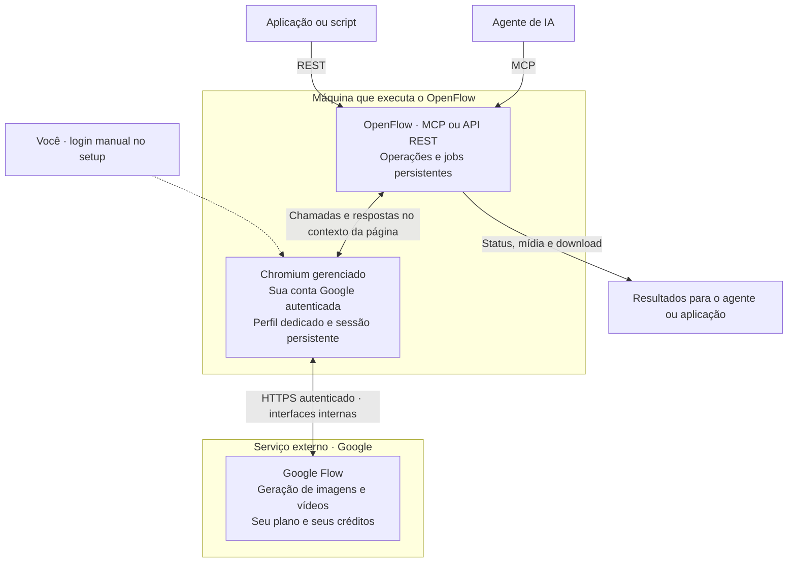

[English](README.md) | **Português (Brasil)**

<p align="center">
  
</p>

# OpenFlow

### Seu agente de IA conectado ao Google Flow.

[](LICENSE)
[](pyproject.toml)
[](https://github.com/codexfast/openflow/stargazers)

[Começar](#setup) · [MCP](#mcp) · [API REST](#rest) · [Como funciona](#architecture) · [Contribuir](#contribuição)

Transforme pedidos ao seu agente em imagens e vídeos no Google Flow. **OpenFlow é a ponte:** um projeto open source que conecta agentes e aplicações à sua conta por **MCP** ou **API REST**, usando os recursos e créditos disponíveis no seu plano Google, como o Google AI Pro.

- **Crie com seu agente.** Geração de imagens e vídeos, referências e upscale, conforme o acesso da conta.
- **Escolha sua interface.** Ferramentas MCP para agentes; REST para aplicações e scripts. Mesmo serviço, duas formas de acesso.
- **Confira antes de enviar.** Prévia, confirmação explícita e histórico de jobs persistido em SQLite.

O login acontece diretamente no Google, em um Chromium dedicado com perfil local persistente. Depois, OpenFlow reutiliza a sessão em headless. **Sem extensão no fluxo padrão e sem enviar cada pedido manualmente na interface.**

> **Não é uma API oficial do Google.** O projeto utiliza interfaces internas do Flow e não tem afiliação ou endosso do Google. A automação pode contrariar termos ou políticas do serviço e resultar em restrições, suspensão ou banimento da conta. Use por sua conta e risco. Acesso, modelos e créditos continuam sujeitos ao plano e à disponibilidade do serviço.

> **Experimental.** Mudanças no Flow podem interromper a integração. A arte de abertura é conceitual, não uma captura de execução; veja a [procedência](docs/assets/README.md).

## Do pedido à geração

**Exemplo ilustrativo de conversa**, não uma execução real. Requer cliente MCP configurado, conta autenticada e projeto selecionado.

> **Você:** Crie uma imagem cinematográfica de uma cabana nas montanhas ao amanhecer, em 16:9.
>
> **Agente:** Preparei uma prévia com esse prompt e o projeto selecionado. O envio pode consumir créditos do Google Flow. Confirma?
>
> **Você:** Confirmo.
>
> **Agente:** Agora envio a operação confirmada e acompanho o job. O download fica disponível quando a geração termina com sucesso.

O agente prepara com `confirm=false` e só envia após sua aprovação, repetindo as mesmas entradas com `confirm=true` e `preview_id` igual ao `job_id` da prévia. **Prévia não gera mídia nem substitui autorização humana.** [Ver sequência MCP](#mcp).

## Índice

- [Requisitos](#requisitos)
- [Instalação e login](#setup)
- [Funcionalidades](#features)
- [Como funciona](#architecture)
- [Uso com MCP](#mcp)
- [Uso com REST](#rest)
- [Segurança, conta e créditos](#security)
- [Compatibilidade e limitações](#compatibilidade-e-limitações)
- [Solução de problemas](#solução-de-problemas)
- [Backend legado](#backend-legado-extensão)
- [Desenvolvimento](#desenvolvimento)
- [Contribuição](#contribuição)
- [Contribuidores](#contribuidores)
- [Histórico de estrelas](#histórico-de-estrelas)
- [Créditos e licença](#créditos-e-licença)

## Requisitos

- Python 3.11 ou superior e [uv](https://docs.astral.sh/uv/getting-started/installation/).
- Conta Google com acesso ao [Flow](https://flow.google.com/), como o oferecido pela assinatura Google AI Pro.
- Créditos e acesso aos modelos necessários para cada operação, conforme o plano.
- Ambiente com interface gráfica para o login inicial; depois, o navegador pode operar em headless.
- Cliente compatível com MCP ou aplicação que faça chamadas HTTP à API REST.

O Chromium dedicado é instalado nos passos abaixo. Não é necessário instalar uma extensão ou compartilhar o perfil pessoal do navegador.

<a id="quick-start"></a>
<a id="setup"></a>
## Instalação e login

### 1. Instalar dependências

```bash
git clone https://github.com/codexfast/openflow.git
cd openflow
uv sync --extra browser
uv run --extra browser playwright install chromium --no-shell
```

No Linux, o Playwright também exige bibliotecas de sistema compatíveis. Se faltarem dependências, consulte as [instruções do Playwright](https://playwright.dev/python/docs/browsers#install-system-dependencies). Os comandos acima não instalam pacotes do sistema com privilégios administrativos.

### 2. Autenticar no Flow

```bash
uv run --extra browser openflow setup
```

Uma janela do Chromium será aberta. **Faça login diretamente no Google e abra o Flow.** Senha e 2FA são informados somente no site, nunca ao agente ou ao OpenFlow.

Feche a janela ou pressione Ctrl+C para encerrar o setup e liberar o perfil. O login fica salvo no perfil dedicado; se a sessão expirar, repita o setup.

### 3. Iniciar MCP ou REST

| Agente com ferramentas MCP | Aplicação ou script via REST |
| --- | --- |
| Configure o cliente para executar o comando abaixo em stdio. | Execute a API e abra `http://127.0.0.1:8100/docs`. |
| `uv run --extra browser openflow` | `uv run --extra browser openflow-api --api-port 8100` |
| [Configuração MCP →](#mcp) | [Exemplo REST →](#rest) |

**O servidor inicia o navegador headless automaticamente.** Não deixe `setup` ou `browser start` aberto em paralelo. MCP e REST são alternativas: execute um por vez com o mesmo perfil.

<a id="features"></a>
## Funcionalidades

| Recurso | Suporte |
| --- | --- |
| **Imagens** | Nano Banana Pro, Nano Banana 2.1 e Nano Banana Lite |
| **Proporções de imagem** | `1:1`, `9:16`, `16:9`, `3:4`, `4:3`; até 4 referências |
| **Vídeos Omni** | Texto, quadro inicial, inicial/final ou até 3 referências; 4, 6, 8 ou 10 s; 360p/720p |
| **Vídeos Veo Lite** | Quadro inicial obrigatório, 8 s, 720p |
| **Upscale** | Imagens 2K/4K conforme conta/plano; 4K exige Ultra. Vídeos 1080p com `scene_id` real |
| **Projetos e mídia** | Listagem e criação de projetos, upload, consulta de jobs e download |
| **Integrações** | MCP stdio/HTTP e REST com schemas OpenAPI |
| **Controle** | Prévia/confirmação, contexto de projeto/documento e jobs persistentes em SQLite |

Os modelos e recursos disponíveis dependem da conta e do plano. O nome Nano Banana 2.1 corresponde ao identificador `nano_banana_2` nos parâmetros da API.

<a id="architecture"></a>
## Como funciona

**Seu agente ou aplicação chama o OpenFlow. O OpenFlow acessa o Google Flow pelo navegador autenticado com a sua conta.**



MCP e REST são **duas formas de acessar o mesmo serviço**, não provedores de geração separados. O Chromium mantém a sessão e executa as chamadas autenticadas; **quem processa a geração é o Google Flow**. O OpenFlow acompanha os jobs e disponibiliza os resultados ao cliente.

- **Login direto no Google.** Você informa senha e 2FA somente no site, durante `openflow setup`, nunca ao agente. Depois, a sessão pode ser reutilizada em headless. Proteja o perfil local: ele contém os dados de autenticação.
- **Sem extensão no fluxo padrão.** O OpenFlow usa um navegador próprio com perfil persistente, sem compartilhar seu perfil pessoal. O diagrama representa esse backend gerenciado; MCP e REST são alternativas, não duas instâncias simultâneas no mesmo perfil.
- **Sem cliques de geração.** As operações são chamadas HTTPS no contexto autenticado; a navegação abre o projeto solicitado antes de preparar a prévia.
- **Projeto obrigatório.** A confirmação exige os mesmos dados, projeto e documento da prévia. Se o contexto mudar, prepare uma nova prévia; o sistema não navega para ressuscitar a anterior.
- **Submissões incertas.** Jobs de resultado incerto ficam identificados para verificação, não são automaticamente ressubmetidos.

<a id="clients"></a>
<a id="mcp"></a>
## Integração MCP

OpenFlow é um **servidor de ferramentas MCP**, não um provedor de chat ou uma API compatível com OpenAI. Use um cliente com suporte a ferramentas MCP, como OpenCode, Claude Code, Codex, Cursor, Cline ou Hermes Agent. Cada cliente tem seu próprio formato de configuração.

### Exemplo: OpenCode

Substitua o caminho absoluto pelo diretório do clone. O cliente inicia o processo stdio; não abra outro servidor manualmente.

```json
{
  "mcp": {
    "openflow": {
      "type": "local",
      "command": [
        "uv", "--project", "/caminho/absoluto/openflow",
        "run", "--extra", "browser", "openflow"
      ],
      "enabled": true
    }
  }
}
```

Comando stdio para outros clientes:

```bash
uv --project /caminho/absoluto/openflow run --extra browser openflow
```

No Windows, use um caminho como `C:\\Projects\\openflow` no JSON.

### Ferramentas e sequência

1. `list_connections`: obtenha o `connection_id` do navegador gerenciado, sem pareamento.
2. `list_projects`: escolha o `project_id` desejado. A listagem retorna à home; faça isso **antes** da prévia, pois navegar invalida prévias de outro documento.
3. `generate_image`, `generate_video`, `upload` ou upscale com `confirm=false`: prepare a operação. A página entra no projeto antes de vincular a prévia.
4. Apresente as entradas ao usuário e aguarde aprovação.
5. Repita a chamada com as mesmas entradas, `confirm=true` e **`preview_id` igual ao `job_id` retornado na prévia**.
6. Consulte `get_job` com `refresh=true`, quando necessário, e use `download` após `completed`.

`create_project` também usa prévia e confirmação; após a criação, o navegador abre o novo projeto. O parâmetro opcional `title` (também no REST `POST /projects` e `/projects/preview`) aceita somente string de 1 a 200 caracteres, não apenas espaços; o padrão é `"OpenFlow project"`. Repita o mesmo título na confirmação.

`generate_image.input.seed` é opcional: `null` ou omitido mantém a escolha aleatória atual; um inteiro estrito entre `1` e `1000000000` fixa o seed enviado ao Flow. Booleanos, strings e números fracionários são rejeitados. Repita o mesmo seed na confirmação; isso não garante imagens idênticas entre mudanças do modelo. Vídeos não aceitam esse parâmetro.

`get_account_status` e `refresh_account` verificam a conta visível e consultam o saldo por HTTPS no navegador gerenciado, sem abrir painéis. O retorno informa `credits`, `credits_source` e `credits_freshness`; uma leitura indisponível retorna `null`, nunca um saldo estimado ou anterior.

### Catálogo de projetos e mídias

`list_projects(connection_id)` e REST `GET /projects?connection_id=<uuid>` mantêm a listagem remota de ID/título dos primeiros 100 projetos. `has_more` informa possível continuação; esta versão não expõe cursor nem garante todas as páginas. Listar projetos pode navegar para a home e invalidar prévias anteriores.

MCP `list_project_media(connection_id, project_id, limit=100)` e REST
`GET /projects/{project_id}/media?connection_id=<uuid>&limit=100` consultam
as mídias referenciadas por cenas do projeto, sem geração nem criação de jobs.
O backend gerenciado prepara o projeto sob lock; a extensão exige a aba do projeto
já selecionada. Ambos revalidam escopo/documento.

A resposta contém `items` com `media_id`, `scene_id`, `kind` (`image`, `video` ou
`unknown`) e `thumbnail_url` opcional, além de `source: "remote_project_scenes"`,
`completeness: "unknown"` e `truncated`. O tipo usa as estruturas de mídia
identificadas no retorno do projeto, não os marcadores `CAE`/`CAI` nem o formato da
miniatura. Estruturas ausentes ou contraditórias mantêm `unknown`.

Miniaturas são URLs HTTPS verificadas do host observado `lh3.googleusercontent.com`;
URLs ausentes ou inválidas resultam em `null`. Podem expirar ou exigir autenticação:
não publique nem registre esses links em logs. O catálogo não baixa miniaturas nem
faz uma chamada adicional por item. Não retorna a URL do arquivo original.

Não representa todas as mídias ou uploads do projeto; uma mídia pode aparecer em
mais de uma cena. Títulos, prompts e outros campos privados não são expostos.
A listagem e as miniaturas não concedem ownership para referências, downloads ou upscale.

`limit` aceita 1 a 100. `truncated` indica somente corte local da resposta retornada,
não completude remota. Não há cursor, snapshot persistido ou paginação automática;
repetir a chamada obtém nova leitura. Respostas com mais de 1000 cenas ou mídias,
IDs inválidos, associação ambígua ou projeto divergente são rejeitadas integralmente,
inclusive registros depois do limite. IDs de mídias com sufixo `_upsampled` são aceitos.

### Exclusão de projeto (somente navegador gerenciado)

`delete_project(connection_id, project_id, confirm=false, preview_id=null)` cria prévia
com título real e alvo. **Exclusão é irreversível: apresente título e ID ao usuário e
aguarde aprovação explícita antes de `confirm=true` com o mesmo `preview_id`.**
Um booleano de confirmação não verifica sozinho aprovação humana.

REST: `POST /projects/{project_id}/delete`, corpo
`{"connection_id":"<uuid>","confirm":false,"preview_id":null}`; confirme com o ID da prévia.
Conta visível verificada, mesmo documento home e título são obrigatórios na confirmação;
identidade desconhecida bloqueia a operação. A leitura não consulta créditos. E-mail não é
persistido pelo job; hash local fica apenas nas entradas privadas, nunca no retorno público.
A lista home é limitada a 100 projetos: alvo ausente falha sem afirmar inexistência.
Títulos com 200 caracteres ou mais são recusados, pois a listagem atual pode truncá-los.

Transporte observado: `QI2zvc ["projects/<project_id>"]`, resposta `[]` HTTP 200.
Antes da exclusão, `UpteDb` confere novamente título/alvo e a conta visível é revalidada.
Prévia é de uso único. `submitting`/`submitted_unverified` bloqueiam novas prévias do mesmo
alvo e conexão; nunca reenvie resultado incerto. Sucesso invalida seleção/documento sem
apagar histórico de jobs. Extensão legacy não suporta exclusão; retorna erro explícito.

### MCP via HTTP

Como alternativa ao stdio:

```bash
uv run --extra browser openflow --transport streamable-http --host 127.0.0.1 --mcp-port 8000
```

Endpoint: `http://127.0.0.1:8000/mcp`. Para clientes remotos, use túnel ou uma camada autenticada e transporte seguro. Não publique a porta diretamente na internet. O servidor deve ter acesso ao navegador, perfil e sessão do sistema operacional usados no login.

<a id="rest"></a>
## API REST

```bash
uv run --extra browser openflow-api --host 127.0.0.1 --api-port 8100
```

[Swagger UI](http://127.0.0.1:8100/docs) · [ReDoc](http://127.0.0.1:8100/redoc) · [OpenAPI](http://127.0.0.1:8100/openapi.json) — disponíveis enquanto a API local estiver executando.

A documentação reflete o backend escolhido. No modo padrão `browser`, não há etapa de pareamento: use o login salvo pelo `openflow setup`. Os endpoints legados de pareamento e seleção de aba aparecem na documentação somente com `--backend extension`; as rotas continuam registradas por compatibilidade.

### Exemplo: gerar e baixar uma imagem

Os comandos abaixo usam Bash, `curl` e `jq`. Execute em sequência no mesmo terminal. O exemplo não escolhe um projeto nem confirma uma geração automaticamente.

**1. Consulte a conexão e os projetos:**

```bash
BASE=http://127.0.0.1:8100
curl -fsS "$BASE/connections" | jq

# Copie o identificador retornado; substitua os placeholders.
CONNECTION_ID='<connection_id>'
curl -fsS --get "$BASE/projects" \
  --data-urlencode "connection_id=$CONNECTION_ID" | jq '.projects'
PROJECT_ID='<project_id>'
```

**2. Prepare uma prévia, sem gerar mídia:**

```bash
INPUT='{"prompt":"Portal circular de titânio e basalto, costa fantástica, água turquesa e luz âmbar","model":"nano_banana_2","ratio":"16:9","references":[]}'

BODY=$(jq -n --arg c "$CONNECTION_ID" --arg p "$PROJECT_ID" --argjson i "$INPUT" \
  '{connection_id:$c, project_id:$p, input:$i, confirm:false}')
PREVIEW=$(curl -fsS "$BASE/images" -H 'Content-Type: application/json' -d "$BODY")
printf '%s\n' "$PREVIEW" | jq
PREVIEW_ID=$(printf '%s' "$PREVIEW" | jq -er 'select(.state == "preview") | .job_id')
```

**3. Somente após conferir a prévia e obter aprovação humana**, execute o bloco separado abaixo. Pode consumir créditos. Não altere `BODY`, não liste projetos nem mude o documento entre a prévia e a confirmação.

```bash
CONFIRM=$(printf '%s' "$BODY" | jq --arg id "$PREVIEW_ID" \
  '.confirm = true | .preview_id = $id')
RESULT=$(curl -fsS "$BASE/images" -H 'Content-Type: application/json' -d "$CONFIRM")
printf '%s\n' "$RESULT" | jq '{job_id, state}'
JOB_ID=$(printf '%s' "$RESULT" | jq -er '.job_id')
```

**4. Consulte o job, sem reenviar a geração:**

```bash
curl -fsS --get "$BASE/jobs/$JOB_ID" \
  --data-urlencode "connection_id=$CONNECTION_ID" \
  --data-urlencode "project_id=$PROJECT_ID" \
  --data-urlencode 'refresh=true' | jq '{job_id, state}'
```

Se estiver `pending`, consulte novamente mais tarde. **`submitted_unverified` não significa falha:** verifique o job e o projeto manualmente antes de qualquer nova submissão.

**5. Apenas após `completed`, baixe o resultado:**

```bash
# Caminho absoluto na máquina do servidor; pasta existente e arquivo ainda inexistente.
DESTINATION='/caminho/absoluto/resultado.jpg'
jq -n --arg c "$CONNECTION_ID" --arg p "$PROJECT_ID" --arg d "$DESTINATION" \
  '{connection_id:$c, project_id:$p, destination:$d, asset_index:0}' |
  curl -fsS "$BASE/jobs/$JOB_ID/download" -H 'Content-Type: application/json' --data-binary @-
```

O download aceita somente resultados de um job concluído e do escopo correspondente. No upscale de imagem, o Flow pode devolver a imagem embutida em vez de um asset com URL: nesse caso, `result.inline_image_available` e `result.download_available` são `true`; use o mesmo endpoint de download com `asset_index: 0`, mesmo com `assets: []`. O retorno do download inclui a resolução solicitada e as dimensões observadas, quando disponíveis; isso não comprova qualidade visual. Não recebe uma URL arbitrária nem sobrescreve arquivos existentes.

### Endpoints principais

| Método | Rota | Finalidade |
| --- | --- | --- |
| `GET` | `/health` | Estado do serviço |
| `GET` | `/connections` | Conexões disponíveis |
| `GET` | `/connections/{connection_id}` | Contexto do navegador |
| `GET` | `/connections/{connection_id}/account` | Evidências de conta; `refresh=true` para atualizar |
| `GET` | `/projects` | Listar projetos com `connection_id` |
| `POST` | `/projects` | Preparar ou confirmar criação de projeto; `title` opcional |
| `GET` | `/projects/{project_id}/media` | Catálogo parcial de mídias ligadas a cenas; `connection_id` e `limit` |
| `POST` | `/projects/{project_id}/delete` | Preparar ou confirmar exclusão permanente; somente navegador gerenciado |
| `POST` | `/images`, `/videos` | Preparar ou confirmar geração |
| `POST` | `/images/upscale`, `/videos/upscale` | Preparar ou confirmar upscale |
| `POST` | `/uploads` | Preparar ou confirmar upload PNG/JPEG/WebP, até 8 MiB |
| `GET` | `/jobs/{job_id}` | Consultar ou atualizar job com conexão/projeto |
| `POST` | `/jobs/{job_id}/download` | Salvar resultado na máquina do servidor |

Os schemas completos e endpoints de compatibilidade estão no OpenAPI local. Não publique respostas com URLs assinadas, dados privados ou informações de conta.

<a id="security"></a>
## Segurança, conta e créditos

- **Créditos.** OpenFlow não fornece créditos nem altera os limites da assinatura. Acesso, modelos e créditos são definidos pelo Google Flow. Confira custos na interface antes de confirmar; o sistema não garante leitura do saldo.
- **Prévia não é autorização.** Agentes e clientes devem apresentar as entradas e obter aprovação humana antes de executar operações confirmadas.
- **Resultado incerto não deve ser reenviado automaticamente.** Um timeout pode ocorrer depois de a operação ter sido aceita e consumido créditos.
- **Proteja o perfil persistente.** Ele contém cookies e dados que permitem acesso à conta. Não compartilhe, versione ou anexe a issues. O navegador usa perfil dedicado e não expõe uma porta TCP de depuração.
- **HTTP é acesso privilegiado.** A API REST não implementa autenticação HTTP própria, pode ler arquivos locais para upload e gravar downloads. Mantenha o serviço local; para acesso remoto, adicione controle de acesso e transporte seguro.
- **Nunca exponha credenciais.** Não publique senhas, cookies, tokens, URLs assinadas, bancos de jobs ou segredos legados em prompts, issues ou logs.
- **Respeite termos e direitos.** A licença do código não concede direitos sobre serviços ou resultados de terceiros.

### Perfil e renovação do login

No Linux, o perfil padrão fica em `~/.local/share/openflow/browser/profile`. Quando `LOCALAPPDATA` está definido, o diretório-base é `LOCALAPPDATA/openflow/browser` e o perfil fica em `profile/`.

Uma trava impede duas instâncias usando o mesmo perfil. Encerre MCP/REST antes de abrir setup ou diagnóstico. No Linux, o processo precisa acessar o keyring/DBus da sessão usada no login.

Para reutilizar um perfil Chromium existente, defina `OPENFLOW_PROFILE` com o caminho absoluto dele. O OpenFlow usa esse diretório no próprio local, sem copiar cookies, e mantém a trava em `<perfil>.lock` ao lado. O perfil não pode estar aberto em outro navegador nem ser um link simbólico.

```bash
# Inspeciona o login salvo e encerra; não gera mídia.
uv run --extra browser openflow browser inspect

# Renova o login em uma janela normal, depois de encerrar o servidor.
uv run --extra browser openflow setup
```

`inspect` omite email, cookies e parâmetros da URL. `account_observed` indica evidência visível de conta, **não** acesso garantido à geração, plano ou créditos. Outros estados incluem `login_required`, `unknown` e `navigation_failed`. Diagnósticos não abrem painéis de conta.

## Compatibilidade e limitações

O projeto utiliza interfaces internas do Flow no contexto do navegador, não uma API pública estável de geração. Alterações no serviço, autenticação, reCAPTCHA, modelos ou planos podem interromper operações. Não há garantia de compatibilidade headless.

- Referências devem pertencer ao projeto e escopo correspondentes.
- Listar projetos retorna à home e pode invalidar prévias de outro documento.
- A troca de conta/documento exige nova prévia; não altere o contexto enquanto aguarda um resultado.
- O schema aceita upscale de imagem 2K/4K, mas disponibilidade depende da conta; 4K exige Ultra e não é garantido.
- Upscale de vídeo exige `scene_id` real; não invente identificadores.
- Veo Lite requer quadro inicial, 8 s e 720p. `veo_lite_low_priority` e `veo_fast_ultra` não são opções implementadas.
- O repositório não fornece imagem Docker ou Compose oficial. Um ambiente remoto precisa de navegador operacional, setup manual e acesso seguro ao perfil/keyring.

## Solução de problemas

| Sintoma | O que verificar |
| --- | --- |
| Chromium/Playwright ausente | Instale o extra `browser` e execute `playwright install chromium --no-shell` |
| Login indisponível ou expirado | Encerre o servidor e execute `openflow setup`; conclua verificações manualmente |
| Perfil em uso | Feche setup, diagnóstico ou outro MCP/REST que esteja usando o mesmo perfil; não remova o lock para forçar concorrência |
| Login salvo não reconhecido no Linux | Execute na sessão com acesso ao mesmo keyring/DBus usado no setup |
| Chromium não inicia no Linux | Confira as dependências de sistema exigidas pelo Playwright |
| `scope_changed` ou projeto divergente | Confira o projeto e prepare nova prévia; não reutilize confirmação de outro documento |
| `submitted_unverified` | Consulte o job e o projeto; não reenvie automaticamente |
| `rpc_rejected` | Confira entradas, modelo e recursos da conta; interfaces internas podem ter mudado |
| `native_recaptcha_automation_unsupported` | A integração esperada não está disponível; verifique a compatibilidade da versão e conclua desafios manuais pelo setup quando necessário |

## Backend legado: extensão

<details>
<summary><strong>Instalação e pareamento da extensão antiga — opcional, não necessário no fluxo padrão</strong></summary>

Este modo usa Google Chrome 116+ e a ponte WebSocket local na porta `9233`, em vez do navegador gerenciado.

1. Abra `chrome://extensions`, ative **Modo do desenvolvedor** e escolha **Carregar sem compactação** na pasta `extension/`.
2. Abra o Flow autenticado e o projeto desejado.
3. Inicie uma entrada explicitamente em modo legado:

```bash
# MCP stdio
uv run openflow --backend extension

# OU REST
uv run openflow-api --backend extension --host 127.0.0.1 --api-port 8100
```

4. Habilite a conexão no popup e compare o código antes de aprovar o pareamento.
5. No MCP, use `list_connections` / `list_pairing_requests`, depois `approve_connection` somente com confirmação humana do código.
6. Use `get_connection` e `select_flow_tab` para fixar o projeto/documento antes da prévia. Prévia e confirmação continuam obrigatórias.

REST mantém `/pairings`, `/pairings/{pairing_id}/approve` e `/connections/{connection_id}/select` para esse fluxo. Pareamento não substitui autenticação de acesso ao servidor HTTP.

Se não conectar, confira o servidor, popup e porta `9233`. Alterar a porta da ponte no servidor não reconfigura a extensão. Após atualizar a extensão, recarregue-a em `chrome://extensions` e recarregue a aba do Flow.

</details>

## Desenvolvimento

```text
src/flow_mcp/
├── cli.py             Setup e comandos de navegador
├── browser.py         Perfil, lock e sessão Chromium
├── managed.py         Backend sem extensão e contexto de projeto
├── server.py          Servidor MCP
├── api.py             API REST
├── service.py         Operações compartilhadas e downloads
├── manager.py         Conexões e escopo
├── jobs.py            Persistência SQLite
└── bridge.py          Ponte legada da extensão
extension/             Backend legado e runtime HTTPS compartilhado
tests/                 Testes Python
```

```bash
uv sync --extra browser --extra dev
uv run --extra browser --extra dev pytest
uv run --extra browser --extra dev ruff check .
uv run --extra browser --extra dev mypy
node --test extension/tests/*.test.mjs
```

Node.js é necessário apenas para os testes JavaScript. Testes reais de geração podem consumir créditos e exigem autorização.

Salve downloads, mídias geradas e outras saídas locais de teste em `artifacts/`, que já é ignorado pelo Git. Esses arquivos não fazem parte do código-fonte e não devem ser incluídos em commits.

## Contribuição

Leia o [guia de contribuição](CONTRIBUTING.pt-BR.md) para preparar o ambiente, executar testes sem conta Google e enviar seu primeiro PR. Veja também as [issues para começar](https://github.com/codexfast/openflow/issues?q=is%3Aissue%20is%3Aopen%20label%3A%22good%20first%20issue%22).

Contribuições de código, testes e documentação são bem-vindas. Mantenha as mudanças focadas, descreva passos de reprodução e execute as verificações pertinentes. Ao relatar problemas, inclua versões do Python, Playwright/Chromium e erros sanitizados; não envie dados de conta ou mídia privada.

## Contribuidores

[](https://github.com/codexfast/openflow/graphs/contributors)

A lista é baseada nas contribuições registradas pelo GitHub. A atribuição do código original está na seção de créditos abaixo.

## Histórico de estrelas

[](https://starchart.cc/codexfast/openflow)

## Créditos e licença

Este projeto deriva do código de **tuannguyenhoangit-droid**. A autoria original é reconhecida e o aviso de copyright permanece preservado:

```text
Copyright (c) 2026 tuannguyenhoangit-droid
```

Distribuído sob a [licença MIT](LICENSE), que permite uso, cópia, modificação, distribuição e uso comercial, inclusive venda, desde que sejam preservados os avisos exigidos pela licença. O software é fornecido sem garantias.

Google, Google Flow e os nomes dos modelos pertencem aos respectivos titulares. Sua menção descreve compatibilidade e não implica afiliação.

[Relatar bug ou propor melhoria](https://github.com/codexfast/openflow/issues) · [Contribuir](https://github.com/codexfast/openflow/pulls) · [Contribuidores](https://github.com/codexfast/openflow/graphs/contributors)
